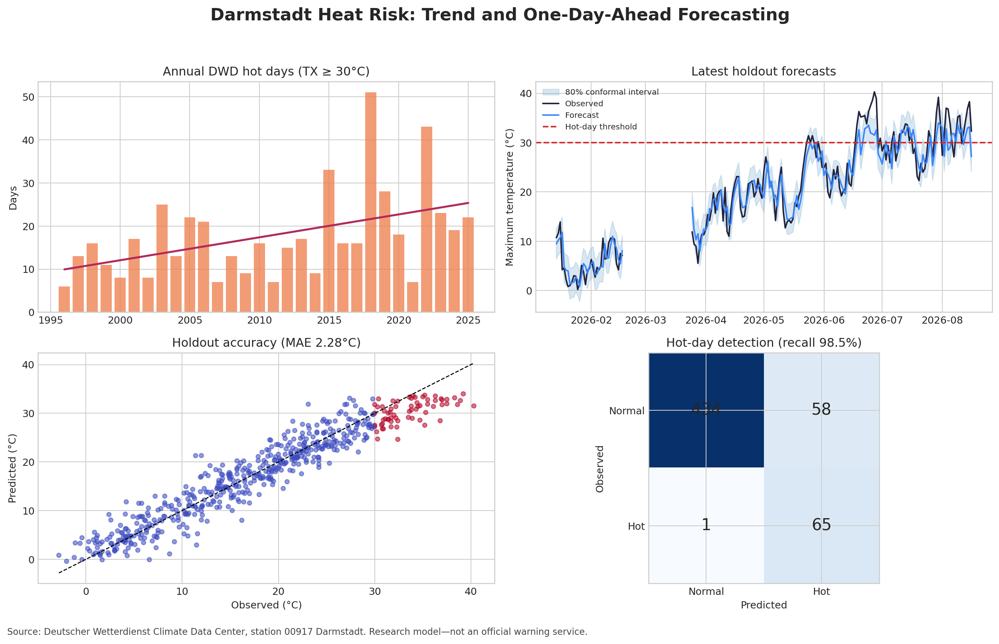

# Rhine–Main Heat Risk Forecasting

[](https://github.com/MUmairSarwar/germany-heat-risk-forecasting/actions/workflows/ci.yml)

Next-day forecasts of maximum temperature and hot-day risk for Darmstadt, built from daily Deutscher Wetterdienst (DWD) observations at station 00917. At the end of day $t$ the model predicts

- the maximum temperature on day $t+1$, with an 80% split-conformal prediction interval, and
- the probability that day $t+1$ is a hot day in the DWD sense ($T_{\max} \ge 30\,^\circ\mathrm{C}$).

The project also estimates the long-term trend in the number of hot days per year. I worked on it from May to August 2026 and published it in August 2026.



## Data

Daily observations from the DWD Climate Data Center, merging the historical and recent archives for station 00917 (Darmstadt). The checked-in run covers 1 August 1995 to 16 August 2026. Seven variables are used: daily maximum, minimum and mean temperature, relative humidity, precipitation, sunshine duration and vapour pressure. DWD's `-999` code is treated as missing, and where the two archives overlap the recent record is kept. Details are in the [data card](docs/data_card.md).

## Method

**Features** ([`features.py`](src/heatrisk/features.py)). Everything is known by the end of day $t$: the day's observations; lags of 1, 2, 3, 7 and 14 days for the temperatures and humidity; trailing 3-, 7- and 14-day means and standard deviations of the temperatures; three Fourier harmonics of the target day of year; and a linear year index. That gives 52 candidate features.

**Chronological splits.** Rows are never shuffled.

| Split | Target dates | Days |
|---|---|---:|
| Train | up to 2022-12-31 | 9,999 |
| Validation (model selection, threshold, calibration) | 2023-01-01 to 2024-12-31 | 731 |
| Holdout | 2025-01-01 onwards | 558 |

**Temperature model** ([`modeling.py`](src/heatrisk/modeling.py)). Ridge regression (with cross-validated $\alpha$) and histogram gradient boosting are fitted on the training set, and the one with lower validation MAE is kept. Persistence ($\hat T_{t+1} = T_t$) and a day-of-year climatology from the training years are reported as baselines.

**Prediction interval.** With validation residuals $r_i = y_i - \hat y_i$, $i = 1, \dots, n$, the interval is $\hat y \pm q$, where $q$ is the $\lceil (n+1)(1-\alpha) \rceil / n$ empirical quantile of $|r_i|$ and $\alpha = 0.2$. Under exchangeability this gives at least 80% marginal coverage. Daily weather is serially dependent and the climate is drifting, so the guarantee is not expected to hold exactly here; the holdout coverage measures how far off it is.

**Hot-day classifier.** A separate class-weighted logistic regression on the same features estimates $P(T_{\max,t+1} \ge 30\,^\circ\mathrm{C})$. Its decision threshold is the value in $\{0.050, 0.055, \dots, 0.950\}$ that maximises $F_2$ on the validation set, so a missed hot day counts more than a false alarm.

**Trend** ([`evaluation.py`](src/heatrisk/evaluation.py)). Hot days are counted for every calendar year with at least 350 valid maximum-temperature observations (1996–2025 in this run). The slope is the Theil–Sen estimator, the median of all pairwise slopes, with a seeded bootstrap over years for a descriptive 95% interval. The straight line on the dashboard is an ordinary least-squares fit drawn for display; the reported slope is Theil–Sen.

More detail is in the [methodology notes](docs/methodology.md) and the [model card](docs/model_card.md).

## Results

From [`outputs/metrics.json`](outputs/metrics.json). Gradient boosting was selected on validation MAE (1.90 °C, against 2.12 °C for ridge and 2.29 °C for persistence).

**Temperature, holdout (558 days)**

| | MAE (°C) |
|---|---:|
| Gradient boosting | 2.28 (RMSE 2.91) |
| Persistence (557 days with a previous observation) | 2.54 |
| Day-of-year climatology | 3.77 |

The model's MAE is 10.3% below persistence on the same 557 days. The conformal radius is 3.07 °C, so the interval is 6.1 °C wide. It covered 71.1% of holdout days instead of the nominal 80%. The holdout errors were larger than the validation errors (MAE 2.28 °C against 1.90 °C), and a fixed radius calibrated on 2023–2024 does not adapt to that. I report the undercoverage rather than recalibrate on holdout labels.

**Hot days, holdout (66 hot days out of 558)**

| | Value |
|---|---:|
| Decision threshold (chosen on validation) | 0.615 |
| Recall | 98.5% |
| Precision | 52.8% |
| F1 | 0.688 |
| PR AUC | 0.767 |
| ROC AUC | 0.968 |
| Brier score | 0.100 |

The classifier catches 65 of the 66 hot days but raises roughly one false alarm for every correct one. That is what the $F_2$ threshold trades for.

**Trend.** The Theil–Sen slope is +0.42 hot days per year over 1996–2025, with a bootstrap 95% interval of 0.19 to 0.61. This is a descriptive trend at one station, not an attribution study.

## Run

```bash
python -m venv .venv
source .venv/bin/activate
python -m pip install -e .
python -m unittest discover -s tests -v
heat-risk run        # download DWD data, train, evaluate, write outputs/
```

Other commands: `heat-risk download` only fetches and saves the daily data, and `heat-risk demo` draws the dashboard from synthetic predictions without network access (CI uses it as a smoke test). `make install`, `make test` and `make run` wrap the same commands.

`heat-risk run` always downloads the current DWD archives, so a new run will include more recent days than the checked-in outputs and the numbers above will change slightly.

## Repository structure

```text
src/heatrisk/   data download and cleaning, features, models, evaluation, dashboard, CLI
tests/          data cleaning, feature leakage, split and conformal-radius tests
docs/           methodology, model card, data card
outputs/        metrics, holdout predictions, annual hot-day counts, dashboard, latest forecast
```

## Limitations

- One station. It does not capture differences within the city or the urban heat-island effect.
- The forecast uses end-of-day observations only, with no numerical weather prediction input, so it is not comparable to an operational morning forecast.
- The interval has a constant width. It does not get wider on unusual days, and it undercovered in the holdout period.
- The holdout has only 66 hot days, so the classification metrics will vary noticeably from year to year.
- The year index takes values beyond the training range in validation and holdout. A tree model treats those like the last training year, so it cannot extrapolate a trend.
- This is a research project, not a warning service. Official DWD heat warnings use forecast data and perceived temperature.

## Data and attribution

Source: Deutscher Wetterdienst (DWD), Climate Data Center, station 00917 Darmstadt. Citation metadata for this repository is in [`CITATION.cff`](CITATION.cff).

## Author

Muhammad Umair Sarwar, M.Sc. Mathematics (Mathematics in Data Science), TU Darmstadt. Other projects are listed on my [GitHub profile](https://github.com/MUmairSarwar).

Code is released under the [MIT License](LICENSE).
